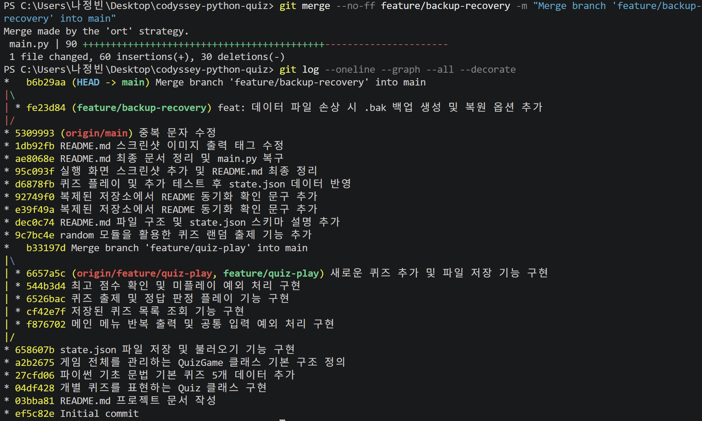
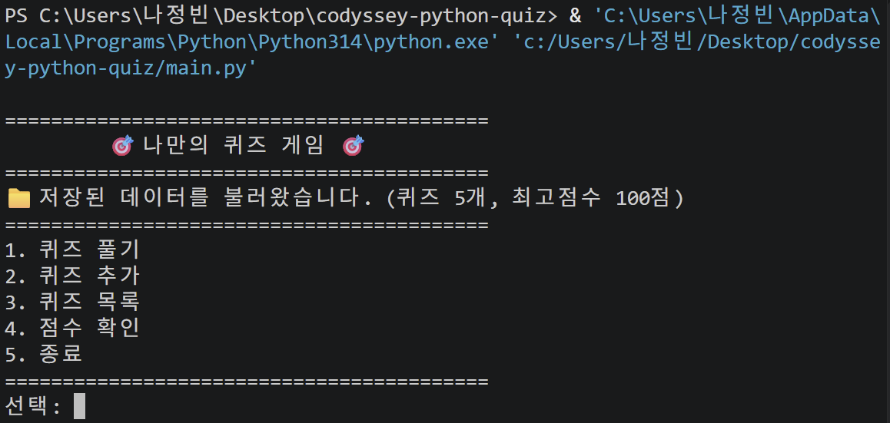
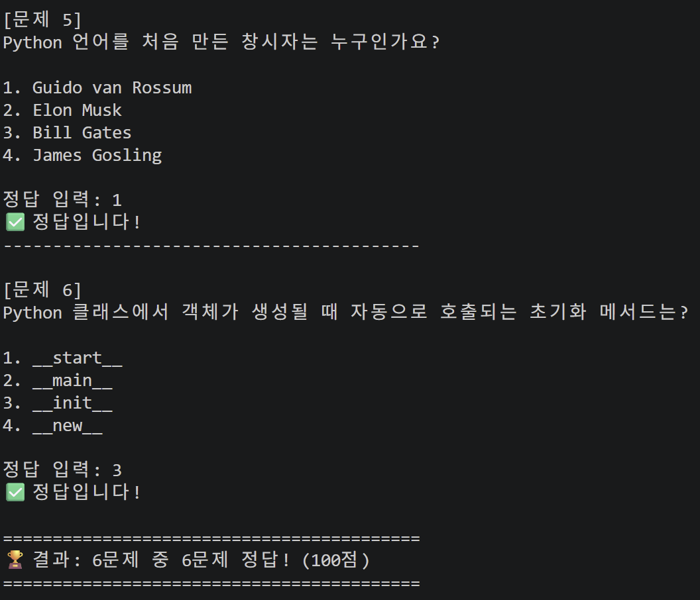
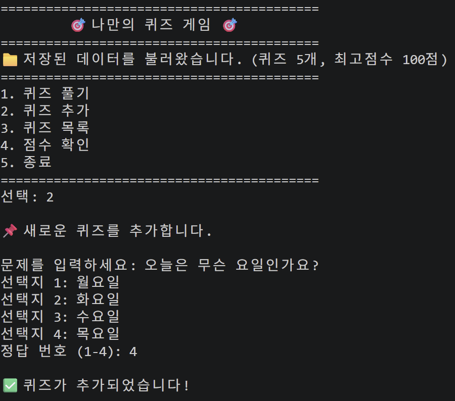
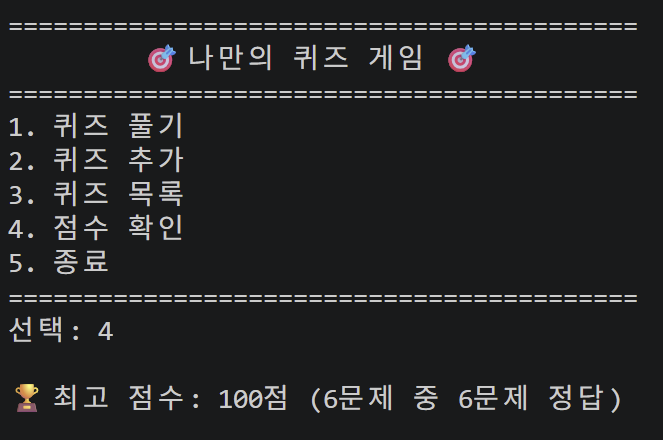
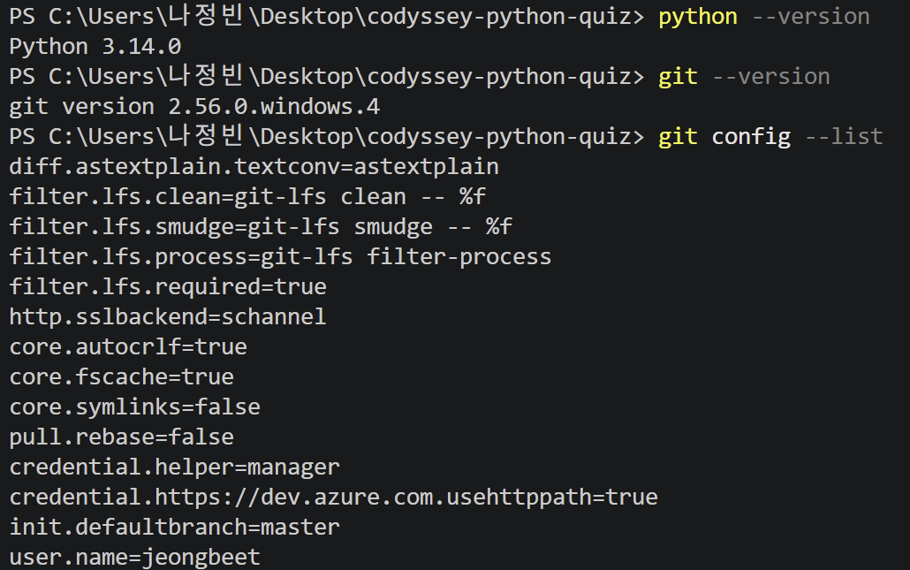

# 🎯 나만의 Python 콘솔 퀴즈 게임 (codyssey-python-quiz)

## 1. 프로젝트 개요
Python 기본 문법과 객체지향 프로그래밍(`Quiz`, `QuizGame` 클래스)을 활용하여 터미널(콘솔) 환경에서 동작하는 퀴즈 게임 프로그램입니다.
JSON 파일 입출력을 통해 프로그램을 종료하고 다시 실행해도 추가한 퀴즈와 최고 점수가 그대로 유지되는 데이터 영속성(Persistence)과 `.bak` 백업 복구 전략을 구현했으며, Git과 GitHub를 통해 기능 단위 커밋과 브랜치 병합 워크플로우를 적용했습니다.

## 2. 퀴즈 주제 선정 이유
- **퀴즈 주제**: Python 기초 문법
- **선정 이유**: 변수, 기본 자료형(`int`, `str`, `list`, `dict`), 조건문, 반복문, 클래스(`__init__`, `self`) 등 미션에서 다루는 Python 핵심 문법을 퀴즈로 풀며 자연스럽게 복습하기 위해 선정했습니다.

## 3. 실행 방법
Python 3.10 이상 환경에서 외부 라이브러리 설치 없이 프로젝트 루트 폴더에서 아래 명령어로 실행합니다.

```bash
python main.py
```

## 4. 기능 목록 (랜덤 출제 / 퀴즈 추가 / 목록 / 점수 / 백업 복구)

1. **퀴즈 풀기 (랜덤 출제)** — 메뉴에서 `1. 퀴즈 풀기`를 선택할 때마다 등록된 모든 문제를 무작위 순서로 한 번씩 출제합니다. 1~4번 중 하나를 입력하면 정답 여부를 바로 알려 주고, 마지막에 100점 만점으로 점수를 표시합니다.
   - `QuizGame.play_quiz()`는 Python 표준 라이브러리 `random` 모듈의 `random.sample(self.quizzes, len(self.quizzes))`로 이번 회차의 출제 목록을 만듭니다. [구현 코드 보기](main.py#L212-L225)
2. **퀴즈 추가**: 문제 내용, 4개의 선택지, 정답 번호(1~4)를 입력받아 새로운 퀴즈를 등록하고 즉시 `state.json`에 저장합니다.
3. **퀴즈 목록**: 현재 저장되어 있는 전체 퀴즈의 개수와 문제 목록을 번호순으로 조회합니다.
4. **점수 확인**: 역대 최고 점수와 정답 개수를 확인하며, 신기록 달성 시 자동으로 최고 점수를 갱신·저장합니다. (미플레이 시 안내 메시지 출력)
5. **공통 예외 처리 및 백업(`.bak`) 복구**: 공백 제거, 비정상 숫자/문자 입력 방어, `Ctrl+C`(`KeyboardInterrupt`)/`EOFError` 감지 시 데이터 저장 후 안전 종료, `state.json` 저장 시 `state.json.bak` 자동 백업 및 파일 손상 시 백업 복원 또는 기본 퀴즈 초기화 선택 옵션을 제공합니다.

## 5. 파일 구조

```text
codyssey-python-quiz/
├── docs/
│   └── screenshots/
│       ├── menu.png       # 메인 메뉴 및 퀴즈 목록 실행 화면
│       ├── play.png       # 퀴즈 풀기 실행 화면
│       ├── add_quiz.png   # 퀴즈 추가 실행 화면
│       ├── score.png      # 최고 점수 확인 실행 화면
│       ├── env.png        # 개발 환경 설정 확인 화면
│       └── git_log.png    # git log --oneline --graph 결과 화면
├── .gitignore             # Git 버전 관리 제외 대상 설정 파일
├── README.md              # 프로젝트 소개, 설계 이유, Git 규칙 및 변경영향도 문서
├── state.json             # 퀴즈 목록 및 최고 점수를 저장하는 JSON 데이터 파일
├── state.json.bak         # 데이터 손상 대비 직전 정상 상태를 보존하는 자동 백업 파일
└── main.py                # Quiz, QuizGame 클래스 및 메인 메뉴 실행 파일
```

## 6. 데이터 파일 설명 (`state.json`) 및 한계/백업 전략

### 1) 기본 사양 및 필드(Key) 구조
- **파일 경로**: 프로젝트 루트 디렉터리 (`./state.json`, 백업: `./state.json.bak`)
- **인코딩 방식**: `UTF-8`
- **역할**: 퀴즈 목록과 최고 점수 기록을 저장하여 프로그램 재시작 시에도 데이터를 유지합니다.

| 필드 이름 (Key) | 자료형 (Type) | 설명 |
| :--- | :--- | :--- |
| `quizzes` | `list[dict]` | 전체 퀴즈 객체 목록을 담는 리스트 |
| `quizzes[].question` | `str` | 퀴즈 문제 내용 |
| `quizzes[].choices` | `list[str]` | 4개의 객관식 선택지 목록 |
| `quizzes[].answer` | `int` | 정답 번호 (`1` ~ `4`) |
| `best_score` | `int` | 역대 최고 점수 (100점 만점 기준) |
| `best_correct` | `int` | 최고 점수 달성 시 맞힌 문제 수 |
| `best_total` | `int` | 최고 점수 달성 시 전체 문제 수 |
| `has_played` | `bool` | 퀴즈 플레이 기록 존재 여부 (`true` / `false`) |

### 2) `state.json` 스키마 예시
```json
{
  "quizzes": [
    {
      "question": "Python 언어를 처음 만든 창시자는 누구인가요?",
      "choices": ["Guido van Rossum", "Elon Musk", "Bill Gates", "James Gosling"],
      "answer": 1
    }
  ],
  "best_score": 100,
  "best_correct": 5,
  "best_total": 5,
  "has_played": true
}
```

### 3) JSON 저장 방식의 한계 및 대용량 처리 대안
- **JSON 저장 방식의 한계 (성능 및 메모리 부담)**:
  1. **전체 읽기/쓰기 오버헤드**: `json.load()`와 `json.dump()`는 파일 전체를 메모리에 적재하고 전체를 새로 덮어쓰는 방식이므로, 퀴즈 데이터가 수만 건 이상으로 커지면 메모리 사용량이 급증하고 디스크 I/O 성능이 저하됩니다.
  2. **부분 조회 및 인덱싱 불가**: 특정 키워드나 난이도의 문제를 조회할 때 인덱스가 없어 전체 배열을 처음부터 끝까지 순차 탐색($O(N)$)해야 합니다.
  3. **동시성 및 트랜잭션 미지원**: 다수의 프로세스가 동시에 파일에 접근할 경우 파일 잠금(Lock)이나 원자적 트랜잭션(ACID)이 보장되지 않아 데이터 유실 및 파일 손상 위험이 있습니다.
- **대용량 처리를 위한 대안**:
  - **로컬 단일 환경**: 파이썬 표준 라이브러리인 **SQLite (`sqlite3`)** DB를 도입하여 테이블 인덱싱을 통한 고속 검색과 `INSERT`/`UPDATE` 쿼리 기반의 부분 수정 및 트랜잭션을 처리합니다.
  - **다중 사용자 서버 환경**: **PostgreSQL / MySQL** 등의 RDBMS로 퀴즈 데이터를 관리하고, 실시간 최고 점수 및 랭킹 집계를 위해 인메모리 데이터 저장소인 **Redis**를 결합합니다.

### 4) 파일 손상 대비 백업(`.bak`) 및 복구 전략
- **자동 백업 생성**: `QuizGame.save_data()`가 호출될 때마다 기존 정상 `state.json` 파일을 `state.json.bak`으로 먼저 복사(`shutil.copy2`)한 뒤 새로운 데이터를 기록하여 직전 정상 버전을 항상 유지합니다.
- **파일 손상 시 복원/초기화 선택 옵션**:
  1. `QuizGame.load_data()`에서 JSON 파싱 오류나 필수 키 누락 감지 시 `⚠️ 데이터 파일이 손상되었습니다.` 경고를 출력합니다.
  2. `state.json.bak` 백업 파일이 존재할 경우 사용자에게 **`y` (백업 복원) / `n` (기본 데이터 초기화)** 선택 옵션을 제공합니다.
  3. 사용자가 `y`를 입력하면 `state.json.bak`의 데이터를 검증하여 원본 `state.json`을 직전 상태로 복원하며, `n`을 선택하거나 백업 파일마저 손상된 경우에는 기본 퀴즈 5개(`get_default_quizzes()`)로 안전하게 초기화합니다. (이때 손상된 원본이 정상 `.bak` 파일을 덮어쓰지 않도록 `create_backup=False`로 보호합니다.)

## 7. 객체지향(OOP) 설계 이유 및 변경영향도 분석

### 1) 클래스 사용 이유 및 함수 중심 설계 대비 장단점
- **클래스(객체지향 프로그래밍, OOP) 채택 이유**:
  - **`Quiz` 클래스**: 개별 퀴즈의 데이터(`question`, `choices`, `answer`)와 관련 동작(`display`, `check_answer`, `to_dict`, `from_dict`)을 하나의 객체로 **캡슐화(Encapsulation)**하여 데이터 구조와 검증 로직의 응집도를 높였습니다.
  - **`QuizGame` 클래스**: 퀴즈 리스트(`quizzes`), 최고 점수(`best_score`), 파일 경로(`file_path`) 등 애플리케이션의 상태(State)를 인스턴스 속성으로 관리하여 **전역 변수(Global Variable) 남용으로 인한 부작용을 방지**하고, 파일 입출력과 게임 진행 흐름을 명확한 메서드 단위로 분리했습니다.
- **함수 중심(절차적/함수형) 설계 대비 차이점 및 장단점**:

| 비교 항목 | 클래스 기반 설계 (OOP - 현재 방식) | 함수 중심 설계 (절차형/함수형) |
| :--- | :--- | :--- |
| **상태(State) 관리** | 객체 내부 속성(`self.quizzes`, `self.best_score`)으로 상태를 안전하게 묶어서 유지 | 모든 함수 호출 시마다 `quizzes`, `best_score`를 매개변수로 매번 전달하거나 전역 변수에 의존 |
| **데이터 무결성** | `Quiz.from_dict()` 등에서 객체 생성 시점에 유효성 검증을 강제하여 일관성 보장 | 딕셔너리(`dict`)를 직접 주고받으므로 오타나 키 누락이 발생하기 쉬움 |
| **유지보수 및 확장성** | 새로운 문제 유형(OX 퀴즈, 주관식 등) 도입 시 `Quiz` 클래스를 상속(Inheritance)하여 다형성 구현 가능 | 문제 형태가 바뀌면 이를 처리하는 모든 함수의 분기문(`if-else`)을 일일이 찾아 수정해야 함 |
| **단점** | 초기 클래스 구조 및 보일러플레이트 코드 설계 비용이 발생함 | 소규모 스크립트에서는 빠르게 작성 가능하나 기능 추가 시 코드 복잡도가 급증함 |

### 2) 요구사항 변경 시 변경영향도 분석
향후 요구사항이 변경되거나 신규 기능이 추가될 때 수정해야 할 대상 파일과 클래스/메서드 범위는 다음과 같습니다.

| 요구사항 변경 시나리오 | 수정 대상 파일 | 수정 대상 클래스 및 메서드 | 세부 수정 내용 |
| :--- | :--- | :--- | :--- |
| **1. 데이터 저장 방식 변경** (JSON → SQLite DB 전환) | `main.py` | `QuizGame.load_data()`, `QuizGame.save_data()`, `QuizGame._parse_and_set_data()` | 파일 입출력(`open`, `json`) 로직을 `sqlite3` 연결 및 SQL 쿼리(`SELECT`, `INSERT`, `UPDATE`)로 교체 (`play_quiz` 등 게임 로직은 수정 불필요) |
| **2. 퀴즈 속성 추가** (난이도, 카테고리, 문제별 배점 추가) | `main.py`, `state.json` | `Quiz.__init__()`, `Quiz.to_dict()`, `Quiz.from_dict()`, `QuizGame.add_quiz()` | `Quiz` 속성과 JSON 직렬화 키에 `difficulty`, `category` 추가 및 `add_quiz()`에 해당 항목 입력 프롬프트 추가 |
| **3. 퀴즈 출제 및 채점 규칙 변경** (문항 수 제한, 타이머, 오답 감점) | `main.py` | `Quiz.check_answer()`, `QuizGame.play_quiz()` | `play_quiz()` 내 문제 추출 개수 조정, 입력 시간 측정 로직 및 점수 계산 수식 변경 |
| **4. 사용자 인터페이스(UI) 변경** (콘솔 → Tkinter GUI 전환) | `main.py` | `Quiz.display()`, `QuizGame.display_menu()`, `QuizGame.get_int_input()` | 데이터/저장 계층(`load_data`, `save_data`)은 그대로 유지하고 입출력(`print`, `input`) 메서드만 GUI 이벤트 핸들러로 교체 |

## 8. Git 워크플로우, 커밋 규칙 및 브랜치 증빙

### 1) 원격 저장소 및 10+ 커밋 / 브랜치 병합 증빙
- **GitHub Repository URL**: [https://github.com/jeongbeet/codyssey-python-quiz](https://github.com/jeongbeet/codyssey-python-quiz)
- **커밋 로그 요약 (`git log --oneline --graph --all`)**:
  - 총 10회 이상의 기능 단위 커밋과 `feature/*` 브랜치 생성 및 `main` 브랜치 병합(`Merge branch ...`) 이력을 아래 스크린샷으로 증빙합니다.



### 2) 커밋 단위 및 메시지 규칙
- **커밋 단위 원칙**:
  - **원자적(Atomic) 커밋**: 하나의 커밋에는 하나의 논리적 작업(단일 기능 구현, 단일 예외 처리 수정, 문서 업데이트 등)만 포함하여 변경 이력 추적과 문제 발생 시 특정 시점으로의 롤백(Revert)이 쉽도록 관리합니다.
- **커밋 메시지 형식 (Conventional Commits 템플릿)**:
  ```text
  <타입>: <변경 사항 요약 (한글 50자 이내, 명령문 형태)>
  ```
- **커밋 타입 및 실제 적용 예시**:
  - `feat`: 새로운 기능 추가 (예: `feat: 데이터 파일 손상 시 .bak 백업 생성 및 복원 옵션 추가`)
  - `fix`: 버그 수정 및 예외 방어 (예: `fix: 메뉴 및 정답 입력 시 빈 값과 범위 외 숫자 예외 처리`)
  - `docs`: 문서 작성 및 보완 (예: `docs: OOP 설계 이유, JSON 한계, 변경영향도 및 Git 워크플로우 문서 보완`)
  - `refactor`: 동작 변경 없는 코드 구조 개선 (예: `refactor: JSON 파싱 및 초기화 로직 내부 메서드로 분리`)
  - `chore`: 초기 세팅 및 환경 구성 (예: `chore: 프로젝트 초기 디렉터리 및 .gitignore 설정`)

### 3) 브랜치 분리 이유 및 병합(Merge) 워크플로우
- **브랜치 분리 이유**:
  - 언제나 정상 실행 가능한 상태를 유지해야 하는 `main` 브랜치를 보호하고, 신규 기능 개발이나 리팩토링 중 발생할 수 있는 런타임 오류·코드 충돌을 독립된 작업 공간에 격리하기 위해 브랜치를 분리했습니다.
- **브랜치 운영 전략**:
  - `main`: 최종 테스트와 검증이 완료된 안정 버전 브랜치
  - `feature/*`: 단위 기능 개발을 위한 브랜치 (예: `feature/quiz-play`, `feature/backup-recovery`)
  - `bugfix/*`: 발생한 오류나 예외 처리 보완을 위한 브랜치
- **병합(Merge)의 의미와 시점 규칙**:
  - 각 `feature/*` 브랜치에서 기능 구현과 콘솔 입출력/예외 테스트가 완전히 통과한 시점에만 `main` 브랜치로 병합합니다.
  - 병합 시 `git merge --no-ff <브랜치명>` 옵션을 사용하여 Fast-Forward를 방지하고 명시적인 **Merge Commit**을 남겨, 어떤 기능 단위가 언제 통합되었는지 그래프 상에서 명확히 식별할 수 있도록 관리합니다.

## 9. 실행 화면 및 검증 스크린샷

### 1) 메인 메뉴 및 퀴즈 목록 (`docs/screenshots/menu.png`)


### 2) 퀴즈 풀기 (`docs/screenshots/play.png`)


### 3) 퀴즈 추가 (`docs/screenshots/add_quiz.png`)


### 4) 점수 확인 (`docs/screenshots/score.png`)


### 5) 개발 환경 설정 확인 (`docs/screenshots/env.png`)


### 6) Git 그래프 로그 (`docs/screenshots/git_log.png`)


> Git clone 및 pull 동기화 실습을 완료했습니다.