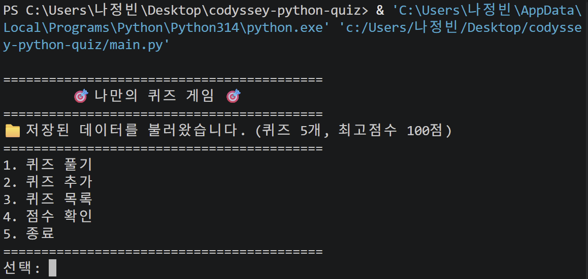
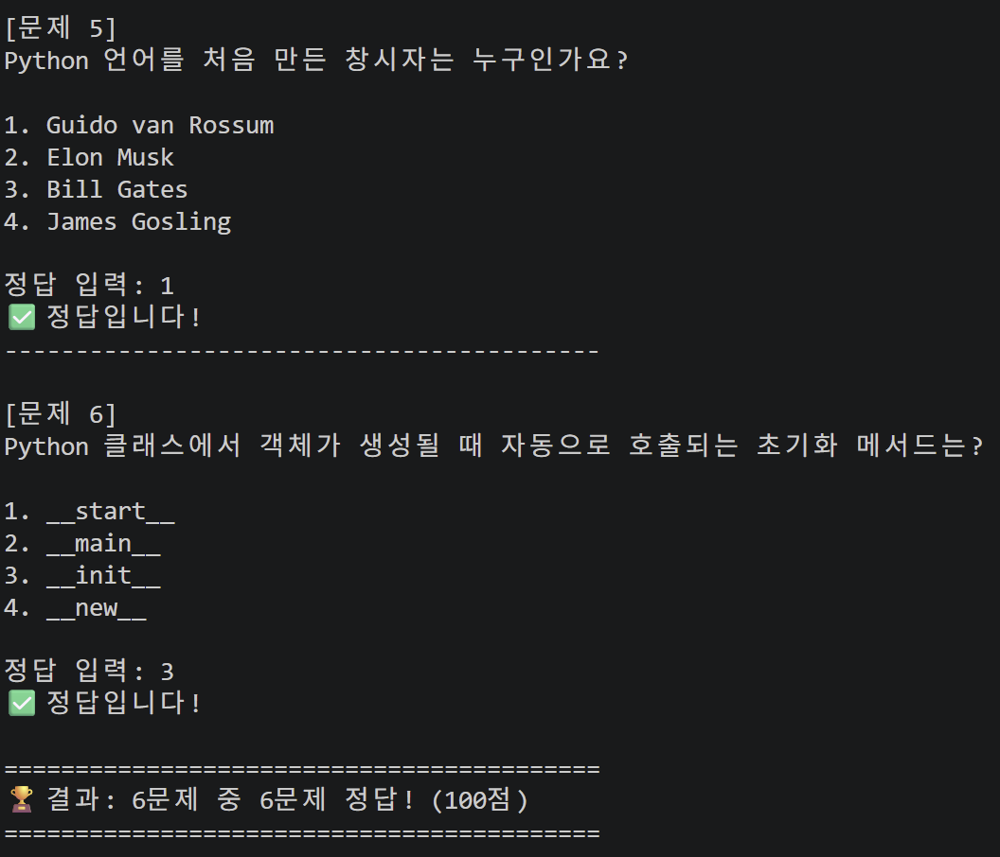
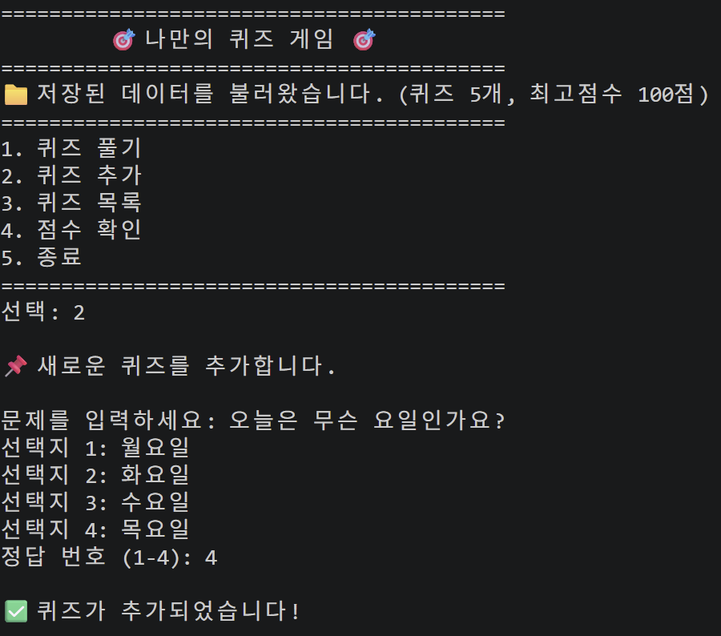
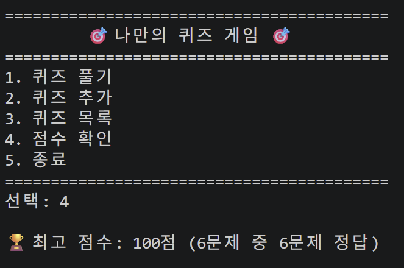
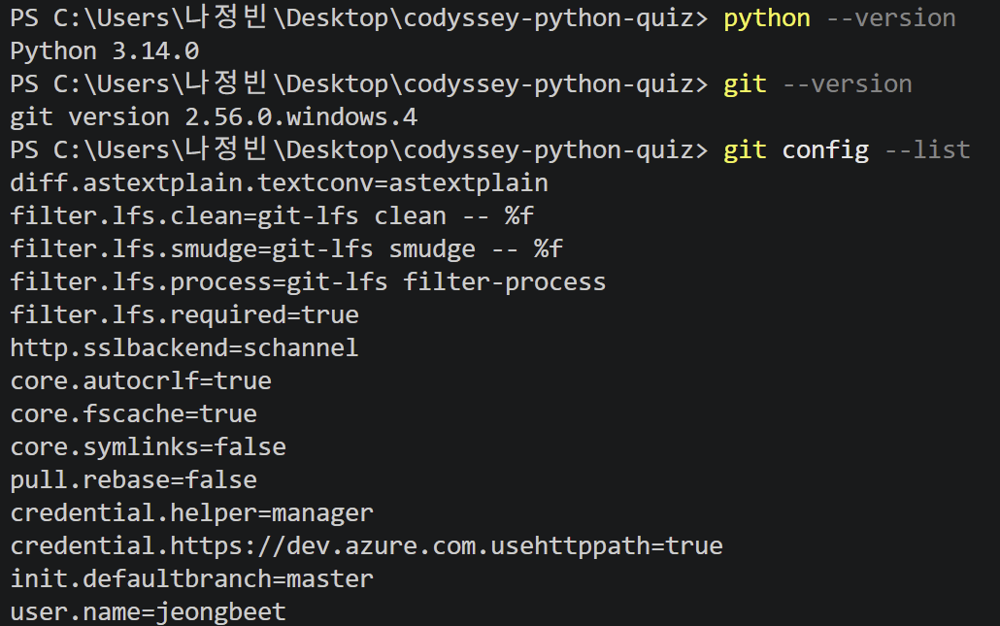
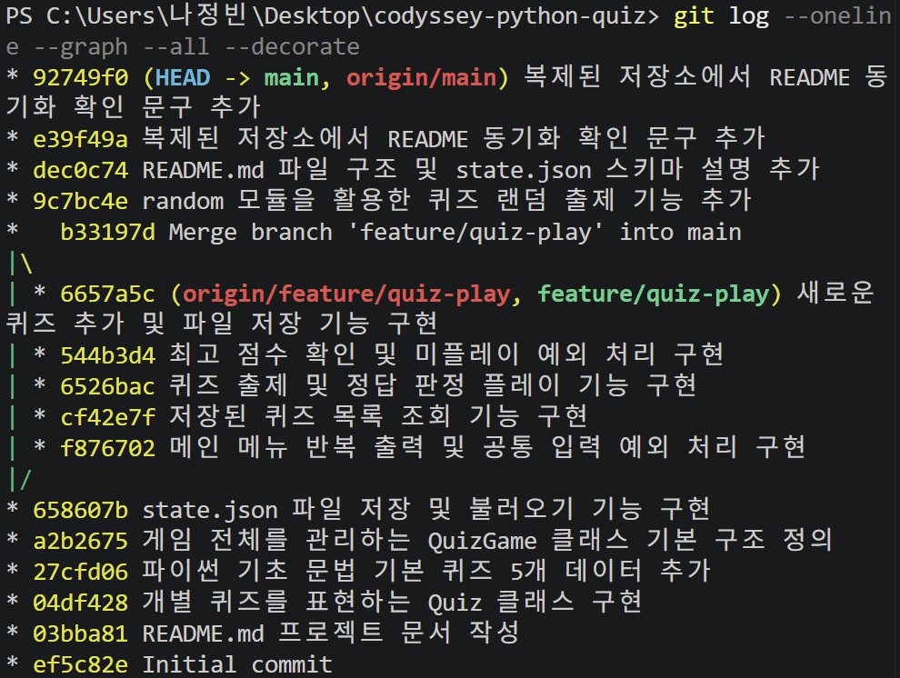

# 🎯 나만의 Python 콘솔 퀴즈 게임 (codyssey-python-quiz)

## 1. 프로젝트 개요
Python 기본 문법과 객체지향 프로그래밍(`Quiz`, `QuizGame` 클래스)을 활용하여 터미널(콘솔) 환경에서 동작하는 퀴즈 게임 프로그램입니다.
JSON 파일 입출력을 통해 프로그램을 종료하고 다시 실행해도 추가한 퀴즈와 최고 점수가 그대로 유지되는 데이터 영속성(Persistence)을 구현했으며, Git과 GitHub를 통해 기능 단위 커밋과 브랜치 병합 워크플로우를 적용했습니다.

## 2. 퀴즈 주제 선정 이유
- **퀴즈 주제**: Python 기초 문법
- **선정 이유**: 변수, 기본 자료형(`int`, `str`, `list`, `dict`), 조건문, 반복문, 클래스(`__init__`, `self`) 등 미션에서 다루는 Python 핵심 문법을 퀴즈로 풀며 자연스럽게 복습하기 위해 선정했습니다.

## 3. 실행 방법
Python 3.10 이상 환경에서 외부 라이브러리 설치 없이 프로젝트 루트 폴더에서 아래 명령어로 실행합니다.

    python main.py

## 4. 기능 목록 (퀴즈 풀기 / 추가 / 목록 / 점수)
1. **퀴즈 풀기 (랜덤 출제 포함)**: 저장된 퀴즈를 `random` 모듈로 매번 랜덤한 순서로 출제하며, 1~4번 정답 입력 후 정답/오답 판정 및 100점 만점 기준 점수를 출력합니다.
2. **퀴즈 추가**: 문제 내용, 4개의 선택지, 정답 번호(1~4)를 입력받아 새로운 퀴즈를 등록하고 즉시 `state.json`에 저장합니다.
3. **퀴즈 목록**: 현재 저장되어 있는 전체 퀴즈의 개수와 문제 목록을 번호순으로 조회합니다.
4. **점수 확인**: 역대 최고 점수와 정답 개수를 확인하며, 신기록 달성 시 자동으로 최고 점수를 갱신·저장합니다. (미플레이 시 안내 메시지 출력)
5. **공통 예외 처리 및 안전한 종료**: 공백 제거, 비정상 숫자/문자 입력 방어, `Ctrl+C`(`KeyboardInterrupt`)/`EOFError` 감지 시 데이터 저장 후 안전 종료, `state.json` 파일 손상 시 기본 퀴즈 5개로 자동 복구합니다.

## 5. 파일 구조

    codyssey-python-quiz/
    ├── docs/
    │   └── screenshots/
    │       ├── menu.png       # 메인 메뉴 및 퀴즈 목록 실행 화면
    │       ├── play.png       # 퀴즈 풀기 실행 화면
    │       ├── add_quiz.png   # 퀴즈 추가 실행 화면
    │       ├── score.png      # 최고 점수 확인 실행 화면
    │       ├── env.png        # 개발 환경 설정 확인 화면
    │       └── git_log.png    # git log --oneline --graph 결과 화면
    ├── .gitignore             # Git 버전 관리 제외 대상 설정 파일
    ├── README.md              # 프로젝트 소개, 실행 방법 및 데이터 구조 설명 문서
    ├── state.json             # 퀴즈 목록 및 최고 점수를 저장하는 JSON 데이터 파일
    └── main.py                # Quiz, QuizGame 클래스 및 메인 메뉴 실행 파일

## 6. 데이터 파일 설명 (`state.json`)
- **파일 경로**: 프로젝트 루트 디렉터리 (`./state.json`)
- **인코딩 방식**: `UTF-8`
- **역할**: 퀴즈 목록과 최고 점수 기록을 저장하여 프로그램 재시작 시에도 데이터를 유지합니다. (파일이 없거나 손상된 경우 기본 퀴즈 5개로 자동 복구)

### 필드(Key) 구조
| 필드 이름 (Key) | 자료형 (Type) | 설명 |
| :--- | :--- | :--- |
| `quizzes` | `list[dict]` | 전체 퀴즈 객체 목록을 담는 리스트 |
| `quizzes[].question` | `str` | 퀴즈 문제 내용 |
| `quizzes[].choices` | `list[str]` | 4개의 객관식 선택지 목록 |
| `quizzes[].answer` | `int` | 정답 번호 (`1` ~ `4`) |
| `best_score` | `int` | 역대 최고 점수 (100점 만점 기준) |
| `best_correct` | `int` | 최고 점수 달성 시 맞힌 문제 수 |
| `best_total` | `int` | 최고 점수 달성 시 전체 문제 수 |
| `has_played` | `bool` | 퀴즈 플레이 기록 존재 여부 (`true` / `false`) |

### `state.json` 스키마 예시

    {
      "quizzes": [
        {
          "question": "Python 언어를 처음 만든 창시자는 누구인가요?",
          "choices": ["Guido van Rossum", "Elon Musk", "Bill Gates", "James Gosling"],
          "answer": 1
        }
      ],
      "best_score": 100,
      "best_correct": 5,
      "best_total": 5,
      "has_played": true
    }

## 7. 실행 화면 및 검증 스크린샷

### 1) 메인 메뉴 및 퀴즈 목록 (`docs/screenshots/menu.png`)

### 2) 퀴즈 풀기 (`docs/screenshots/play.png`)

### 3) 퀴즈 추가 (`docs/screenshots/add_quiz.png`)

### 4) 점수 확인 (`docs/screenshots/score.png`)

### 5) 개발 환경 설정 확인 (`docs/screenshots/env.png`)

### 6) Git 그래프 로그 (`docs/screenshots/git_log.png`)

> Git clone 및 pull 동기화 실습을 완료했습니다.